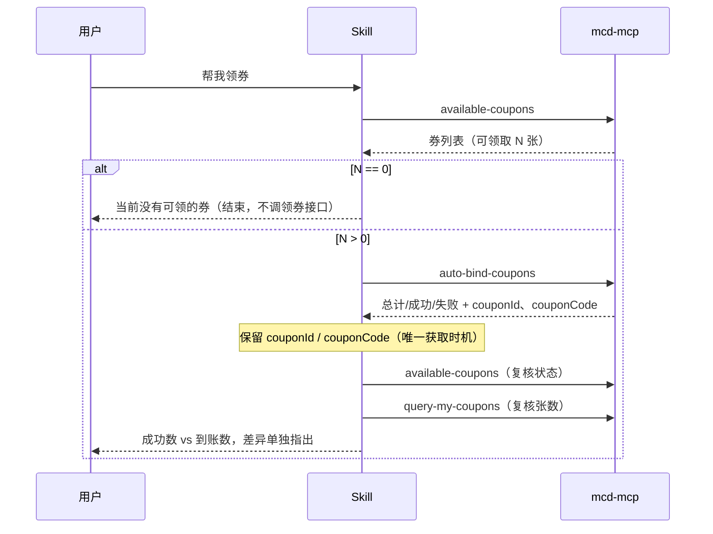
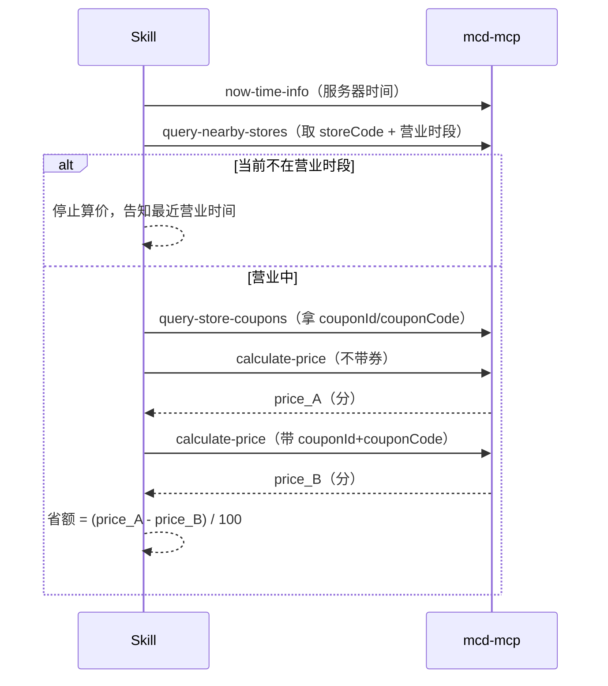
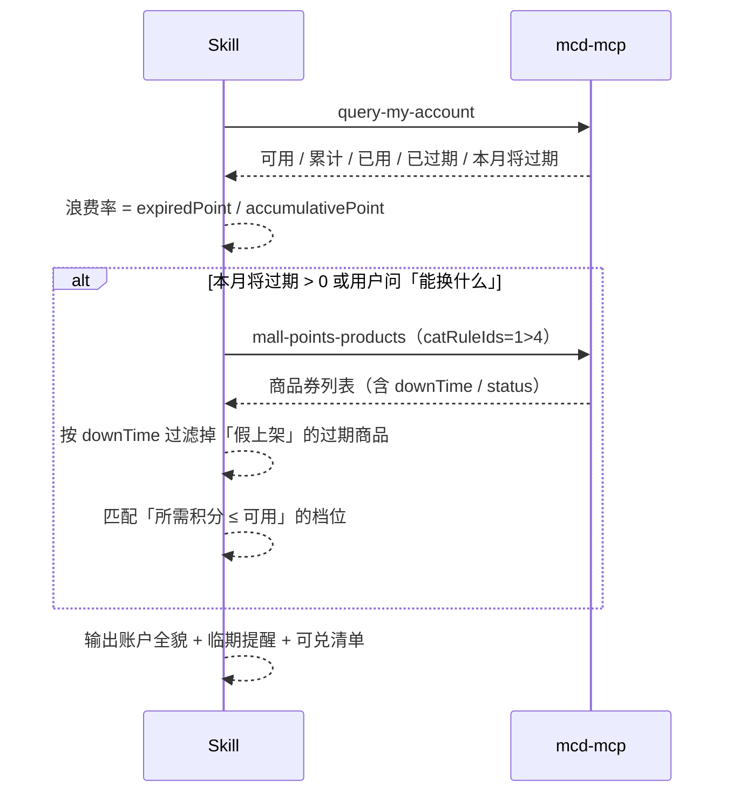

# MCP 集成说明

本文档说明「麦麦领券助手」实际使用的麦当劳 MCP Server、Tool、调用流程与业务价值。
所有结论均来自对 `mcd-mcp` 的**真实调用**，不是照文档转述。

---

## 一、MCP Server

| 项 | 值 |
|---|---|
| 名称 | `mcd-mcp`（麦当劳中国官方 MCP） |
| 传输方式 | `streamablehttp` |
| 端点 | `https://mcp.mcd.cn` |
| 鉴权 | `headers.Authorization: Bearer <MCD_MCP_TOKEN>` |
| 工具总数 | 35 个（账号/门店/餐品/定价/订单/券/促销/积分商城/派对/抽奖） |
| 本项目使用 | 9 个（券链路 6 个 + 积分链路 2 个 + 取餐品编码 1 个） |

Token 与用户麦当劳会员账号绑定，**属于敏感凭证**。仓库内仅提供 `mcp-config.example.json`，只含 `${MCD_MCP_TOKEN}` 占位符，不含真实凭证。

---

## 二、使用的 Tool

### 核心链路（6 个）

| Tool | 作用 | 关键入参 | 关键出参 | 营业时间敏感 |
|---|---|---|---|---|
| `now-time-info` | 取服务器时间，做营业判定基准 | 无 | 服务器当前时间 | 否 |
| `available-coupons` | 查当前可领的券 | 无 | 券名、状态（可领取/已领取） | 否 |
| `auto-bind-coupons` | 一键领取全部可领券 | 无 | 总计/成功/失败 + 每张券的 `couponId`、`couponCode` | 否 |
| `query-my-coupons` | 盘点已持有的券 | `page`、`pageSize` | Markdown 文本：券名、用券价、有效期、标签 | 否 |
| `query-nearby-stores` | 查门店与营业时间 | `beType=1`(到店)/`5`(得来速)、`searchType`、`city`、`keyword` | `storeCode`、`businessStartTime`、`businessEndTime` | 否 |
| `query-store-coupons` | 查**当前门店可用**的券 | `storeCode`、`orderType`、`beType`（外送/团餐需 `beCode`） | `couponId`、`couponCode`、`products[].productCode` | **是** |
| `calculate-price` | 算价（带券/不带券） | `storeCode`、`orderType`、`beType`、`items[]`（可含 `couponId`+`couponCode`） | `price`（单位：**分**）、`enjoyed.realDiscount` | **是** |

### 辅助（1 个）

| Tool | 用途 |
|---|---|
| `query-meals` / `query-meal-detail` | 取 `productCode`。`calculate-price` 必须用真实商品编码，编码需按场景（到店/外送/团餐）分别获取，**不可跨场景复用** |

### 积分链路（2 个）

| Tool | 作用 | 关键入参 | 关键出参 | 备注 |
|---|---|---|---|---|
| `query-my-account` | 积分账户全貌 | 无 | `availablePoint`、`accumulativePoint`、`usedPoint`、`expiredPoint`、`currentMouthExpirePoint`、`nextMouthExpirePoint`、`frozenPoint` | 字段值是**字符串**，需转数字；含 `accountId`，不要输出 |
| `mall-points-products` | 积分可兑换商品券 | `catRuleIds`（`1>4` 商品券 / `2>8` 周边 / `1>6>x` 派对类） | `spuName`、`spuId`、`point`、`price`、`upTime`、`downTime`、`status` | **大量已过期商品仍标 `status=2` 上架**，必须按 `downTime` 过滤 |

> `query-survey-coupon` 需传 `orderId`，作用是查某订单的 CSAT 满意度答卷，**不是发券入口**，因此未纳入链路。

---

## 三、调用流程

### 流程 A：一键领券（无门店依赖，可全时段执行）

**为什么要有复核这一步**：实测出现过 `auto-bind-coupons` 报「成功 3 张、失败 0 张」，但 `query-my-coupons` 的张数只从 5 变成 7——「免费脆薯饼」没有到账。只信接口计数会给出错误结论。

### 流程 B：按门店算用券实付（必须营业中）

### 流程 C：离线结构化（解析器，不依赖 MCP）

`query-my-coupons` 返回 Markdown 文本 → `scripts/parse_coupons.py` → 结构化 JSON（含 `usable_now`、`days_left`）。
这样「今天哪张券此刻能用」可以由程序判定，而不是靠模型逐条读文本。

### 流程 D：积分管家（不依赖门店与营业时间）

**为什么必须先过滤 `downTime`**：接口返回的 25 条商品券里有 16 条 `downTime` 已过（落在 2026-01-10 / 03-21 / 06-24），但 `status` 仍然是 `2`（上架）。只按 `status` 判断会展示一堆兑不了的商品，用户点进去必然失败。

---

## 四、业务价值

### 1. 把「领券」从一次性动作变成可核对的闭环

大多数领券工具止步于「接口返回成功」。本项目把**接口状态**与**券包实际张数**做交叉验证，差异必须暴露给用户。这是用户唯一无法自己发现、但真实存在的损耗。

### 2. 把「券的可用性」算清楚

券的有效期不是一个日期区间，而是**日期区间 × 星期限定 × 每日时段**三重约束，且存在四种书写格式：

| 格式 | 样例 |
|---|---|
| 跨日 + 星期 + 时段 | `2026-10-19 10:30-2026-10-23 23:59 周一、二、三、四、五 10:30-23:59` |
| 纯日期区间 | `2026-10-19 00:00-2026-10-25 23:59` |
| 单日 + 星期 + 时段 | `2026-10-19 05:00-2026-10-19 10:29 周一 05:00-10:29` |
| 跨日 + 时段（无星期） | `2026-10-19 00:00-2026-10-25 23:59 10:00-22:00` |

早餐券集中在 `05:00–10:29`，是券包里最容易被浪费的一类。解析器对 4 种格式都有测试覆盖。

### 3. 给出真实的「省多少」，而不是券面价

券面写着「9.9 元」，但省额 = 原价 − 用券价，只有结合 `calculate-price` 才成立。同一份餐品算两次价，差额即真实省额，同时可读 `enjoyed.realDiscount` 校验。

### 4. 支撑定时任务

领券接口不检查营业时间，算价接口检查。这条差异让「每天 10:35 自动领券」成为可落地的自动化：券普遍在 10:30 生效，10:35 执行既能拿到当日新券，又避开了生效前的空窗。

### 5. 把「看不见的损耗」变成可量化数字

优惠券过期还能从券包看出来，**积分过期完全无声**。`expiredPoint` 这个字段几乎没人用，但它能回答一个重要问题：「我到底浪费了多少」。

实测账户：累计 2277.8、已用 279、已过期 1107.7、可用 891.1——三者相加恰好等于累计值，账是自洽的，**48.6% 的积分已经过期**。把浪费率算出来，比只报一个余额有用得多。

---

## 五、实测避坑（均有真实失败对应）

| # | 现象 | 原因 | 处理 |
|---|---|---|---|
| 1 | `available-coupons` 抛 `Structured content does not match the tool's output schema: data/data must be array` | 无券或服务波动时返回结构不符合自身 schema | 视为**可重试的临时故障**，不得断言「没有券可领」 |
| 2 | 领券成功数 > 券包新增数 | 券发放与入包存在异步/失败 | 双向核对，差异如实上报 |
| 3 | `query-store-coupons` 返回空数组 | 可能是门店无券，也可能是**门店打烊** | 先看 `businessStartTime/EndTime` 与当前时间，再判断 |
| 4 | `calculate-price` 返回 `60003 门店暂停营业` | 算价强依赖营业状态 | 打烊时停止算价，改为提示营业时段 |
| 5 | 券接口返回 Markdown 而非 JSON，含 `` 标签 | 面向大模型阅读的文本格式 | 正则清洗，图片标签不进入结构化数据 |
| 6 | 部分券缺少「领取时间」字段 | 字段非必返 | 解析器按可选字段处理（有测试覆盖） |
| 7 | 已持有券拿不到 `couponId` | `query-my-coupons` 不返回；`couponId` 只在 `auto-bind-coupons` 那一刻给出 | 领券时立即留存；丢失后无法补取，不做臆造 |
| 8 | 同一商品在团餐场景报「不可售」 | 到店/外送/团餐是**三套独立 SKU 与价格体系**，`beCode` 必须按场景获取 | `productCode` 不跨场景复用 |
| 9 | 积分商城商品点进去兑不了 | `status` 仍为 `2`（上架），但 `downTime` 早已过期（25 条里 16 条如此） | 以 `downTime` 为准过滤，不能只信 `status` |
| 10 | 积分字段做运算时报类型错误 | `query-my-account` 的积分数值是**字符串**（`"891.1"`） | 先转 `float` 再算，展示时保留一位小数 |

> 补充：`campaign-calendar`、`query-my-coupons` 只返回人读文本，日期与 ID 藏在正文里，无法稳定结构化——这也是本项目**没有**把「活动提醒」做进来的原因。

---

## 六、实测范围说明

对 `mcd-mcp` 的 35 个工具实测了 18 个：**17 个可用，1 个**（`available-coupons`）在无券时出现过协议错误，复测已恢复。

另有 1 个工具（`query-survey-coupon`）只做了参数结构核查：它必须传 `orderId`，用途是查某订单的满意度答卷，不是领券入口，因此未实际调用也不纳入链路。

写操作中，仅 `auto-bind-coupons`（领券）在测试账号上实际执行过；其余写操作（`create-order`、`cancel-order`、`delivery-create-address`、`mall-create-order`、`party-order-create`、`draw-lottery`）**均未执行**，只记录参数结构，避免产生真实消费与副作用。
