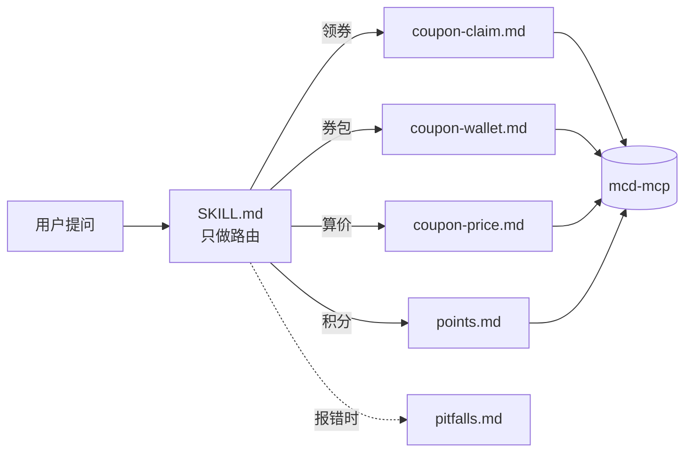

# 🍟 麦麦领券助手 mcd-coupon-helper


   

> 一个跑在 WorkBuddy 里的麦当劳**省钱管家**：管券，也管积分。
> 券：**一键领券 → 核对真的到账 → 盘券包 → 算真实省多少**。
> 积分：**查余额 → 算过期 → 该换什么**。
> 基于麦当劳中国官方 MCP（`mcd-mcp`）开发，麦当劳程序员节创意开发大赛参赛作品。

---

## 💔 为什么做这个

麦当劳的省钱动作，每一步都有个「看起来成了、其实没成」的坑。这个 Skill 就是来填这些坑的：

| 坑 | 实际情况 | 本项目的处理 |
|---|---|---|
| **领了不一定到账** | 实测领 3 张，券包只 +2 张，接口却报「成功 3 张、失败 0 张」 | 强制双向核对（券状态 + 券包张数），差几张、差哪张，直接指出来 |
| **券的可用窗口极窄** | 有效期是「日期区间 × 星期限定 × 每日时段」三重约束，早餐券常只有 `05:00–10:29` | 按三重约束逐张判定「此刻能不能用」，不是只看日期 |
| **说得出「省多少」的工具很少** | `query-my-coupons` 只是资产列表，不校验门店能不能用 | 门店可用券 + 算价接口**双算**（带券/不带券各一次），给出真实实付与差额 |
| **积分会悄悄过期** | 积分过期没有任何提醒，见下一节 | 算出「本月将过期」与历史浪费率，并给出兑换建议 |

---

## 😱 还管积分：因为 1107.7 分悄悄过期了

写这个 Skill 时顺手查了一下自己的积分账户，结果有点心疼：

| 项目 | 积分 |
|---|---|
| 累计获得 | 2277.8 |
| 已使用 | 279 |
| **已过期** | **1107.7** |
| 当前可用 | 891.1 |

279 + 1107.7 + 891.1 = 2277.8，三个数字刚好对得上——**累计获得的积分里，48.6% 已经过期浪费掉了**，实际只花掉 12%。而这期间没有任何提醒。

所以积分场景做了三件事：

1. **把浪费说清楚**：直接算「已过期 / 累计」的占比，而不是只报一个可用余额
2. **盯住临期**：`currentMouthExpirePoint` 一有值就提醒，并指出「这 50.1 分能换什么」
3. **过滤假上架**：积分商城里 **25 条商品券有 16 条已经过期却仍标着「上架」**，全都按 `downTime` 剔除掉，只留真正能兑的 9 条

> 💡 顺带讲清一个容易误解的点：积分兑换的是**「以券面价购买」的资格**，不是免费白拿。「6.9 元香芋派」需 50 积分，意思是 **50 积分 + 6.9 元**。

---

## 🎯 它能回答的问题

- 「帮我领券」→ 领完给到账核对结果，缺的券点名指出
- 「我有哪些券快过期了」→ 按今日 / 3 日内 / 稍后三档排好，标注可用时段
- 「这家店用这张券，实际多少钱」→ 原价 → 用券价 → 省 X 元（Y%）
- 「我的积分快过期了吗」→ 余额全貌 + 浪费率 + 临期金额
- 「积分能换什么」→ 已剔除下架的兑换清单 + 是否够换

### 一个真实输出长这样

```
券包共 7 张

今日到期（1 张）
| 券名 | 用券价 | 可用时段 | 场景 |
|---|---|---|---|
| 火腿扒堡早餐两件套 | ¥9.90 | 10-19 05:00 ~ 10:29 | 到店 |

3 日内到期（2 张）
| 芝香脆鸡扒堡早餐两件套 | ¥9.90 | 10-20 05:00 ~ 10:29 | 到店 |
| 高达芝士蛋堡早餐两件套 | ¥9.90 | 10-21 05:00 ~ 10:29 | 到店 |

⚠️ 三张早餐券分别在周一、周二、周三，每天只有 5.5 小时窗口，睡过头就没了。
```

---

## 📦 安装

> 完整版（8 个客户端的配置片段、AI 代配指令、故障排查表）：**[docs/INSTALL.md](docs/INSTALL.md)**

### 第 0 步：申请一个 MCP Token（必做）

Token 与你的麦当劳会员账号绑定，领券、查积分、算价都靠它识别你是谁。

1. 打开 **https://open.mcd.cn/mcp**
2. 右上角【登录】→ 用**手机号 + 验证码**登录（就是你的麦当劳账号）
3. 登录后右上角变成【控制台】→ 点开 → 点**【激活】**
4. 阅读并同意服务协议 → Token 生成，点**一键复制**

> 🔒 Token 等同账号凭证：**不要提交到 GitHub、不要发在群里**。本仓库只提供 `${MCD_MCP_TOKEN}` 占位符。
> 官方图文指南：[M-China/mcd-mcp-server](https://github.com/M-China/mcd-mcp-server)

### 第 1 步：接到你的 AI 客户端（任选一个）

服务端就三个值，所有客户端通用：

| 项 | 值 |
|---|---|
| 接入地址 | `https://mcp.mcd.cn` |
| 传输协议 | **Streamable HTTP** |
| 鉴权头 | `Authorization: Bearer <你的 Token>` |

**WorkBuddy**：左侧【专家·技能·连接器】→【连接器】→ 右上【自定义连接器】→【配置 MCP】→ 粘贴 `mcp-config.example.json` 的内容（换成真实 Token）→ 保存 → **启用**。

**其他客户端**一句话：把上面三个值填进对应的配置位置。

| 客户端 | 配置放哪里 |
|---|---|
| Claude Code | `.mcp.json`，或 `claude mcp add --transport http` |
| Codex CLI | `~/.codex/config.toml` → `[mcp_servers.mcd-mcp]` + `bearer_token_env_var` |
| Cursor | 设置 → Tools & MCP → Add Custom MCP |
| Trae | 设置 → MCP → 手动添加（记得切到 `Builder with MCP` 模式） |
| Qoder | 设置 → MCP → + Add（**不要写 `type` 字段**，写了反而不识别） |
| VSCode | `.vscode/mcp.json`（用 `inputs` 存 Token 更安全） |
| Cherry Studio | 设置 → MCP → 从 JSON 导入 |

→ 每个客户端的**完整配置片段**见 [docs/INSTALL.md](docs/INSTALL.md#第-1-步把-mcp-接到你的-ai-客户端)

### 第 2 步：装上 Skill（可选，但强烈建议）

**接 MCP = 让 AI 有手；装 Skill = 给它一本操作手册。**

不装也能用，但 AI 可能跳过「领券后核对到账」这一步——而实测中正是因为这一步，才发现「领 3 张只到账 2 张」。

**WorkBuddy 用户**，把 `SKILL.md` 和 `references/` 一起复制到：

```
Windows:      C:\Users\<你>\.workbuddy\skills\mcd-coupon-helper\
macOS/Linux:  ~/.workbuddy/skills/mcd-coupon-helper/
```

**Claude Code 用户**，放 `.claude/skills/mcd-coupon-helper/` 即可，用的是同一套 `SKILL.md` 约定。

**其他客户端**没有 Skill 目录，最省事的办法是让 AI 自己读：

```
先读这两个文件当作你的操作手册，然后按里面的流程帮我做事：
https://github.com/zxyyxzzxy/mcd-coupon-helper/blob/main/SKILL.md
https://github.com/zxyyxzzxy/mcd-coupon-helper/tree/main/references

读完先告诉我：领券之后必须做哪一步核对？
```

最后那句反问是关键——它在检验 AI 到底有没有真的读到「双向核对」这条铁律。

### 🤖 不想手动配？让 AI 来配

把这段直接丢给 AI，它会帮你写好配置文件：

```
帮我配置麦当劳 MCP：
- 名称 mcd-mcp，地址 https://mcp.mcd.cn，传输 Streamable HTTP
- 鉴权头 Authorization: Bearer <我的 token>
- 先确认当前客户端类型和配置文件位置，不要猜
- 优先用环境变量 MCD_MCP_TOKEN 承载 token，不要明文写进会被提交的文件
- 已有配置追加，不要覆盖我其他的 MCP
- 配完调用 now-time-info 验证，把返回的时间给我看
我的 token：______
```

→ 完整版（含 WorkBuddy 专用指令、明文 vs 环境变量的风险对比）见 [docs/INSTALL.md](docs/INSTALL.md#不想手动配让-ai-帮你配)

### 只用解析器（不接 MCP）

券包接口返回的是 Markdown 文本，`scripts/parse_coupons.py` 可以把它变成结构化 JSON：

```bash
python3 scripts/parse_coupons.py fixtures/coupons_sample.md
python3 scripts/parse_coupons.py --now "2026-10-19T08:00:00" fixtures/coupons_sample.md
```

纯标准库实现，无第三方依赖，Python 3.8+。

```bash
python3 -m unittest discover -s tests -v   # 19 个测试，覆盖 4 种有效期格式与可用性判定
```

---

## 🏗 架构：主文件只管路由

场景一多，Skill 最容易出的问题是**描述互相打架**——模型选错路径，用户体感就是「时灵时不灵」。所以这里做了拆分：主文件只留一张路由表，细节按需加载。



| 文件 | 职责 | 行数 |
|---|---|---|
| `SKILL.md` | 触发词、铁律、路由表、意图识别 | 59 |
| `references/coupon-claim.md` | 查可领券、一键领券 + 双向核对 | — |
| `references/coupon-wallet.md` | 券包盘点、三档排序 | — |
| `references/coupon-price.md` | 门店可用券 + 算价双算 | — |
| `references/points.md` | 积分账户、过期预警、兑换建议 | — |
| `references/parsing.md` | 有效期 4 种格式、字段可靠性 | — |
| `references/pitfalls.md` | 10 条实测坑 | — |

主文件从 159 行压到 59 行，**触发准确率和可维护性同时提升**。

---

## 🗂 目录结构

```
mcd-coupon-helper/
├── SKILL.md                      # 路由表：触发词、铁律、意图分流
├── references/                   # 按需加载的场景细节
│   ├── coupon-claim.md
│   ├── coupon-wallet.md
│   ├── coupon-price.md
│   ├── points.md
│   ├── parsing.md
│   └── pitfalls.md
├── scripts/parse_coupons.py      # 券 Markdown → 结构化 JSON（纯标准库）
├── tests/test_parse_coupons.py   # 19 个单元测试
├── fixtures/coupons_sample.md    # 真实返回样本（已脱敏）
├── assets/demo.png               # README 配图
├── docs/INSTALL.md               # 安装与接入指南（8 个客户端 + AI 代配 + 排错）
├── MCP_INTEGRATION.md            # 用了哪些 MCP Tool、调用流程、业务价值
├── mcp-config.example.json       # 脱敏配置示例
├── CONTEST_DECLARATION.md        # 参赛声明（官方原文，未作任何改动）
└── workbuddy.md                  # 使用 WorkBuddy 开发的对话上下文
```

---

## ✅ 能做什么 / 🚫 不能做什么

| 能做 | 做不到，以及原因 |
|---|---|
| 查可领券、一键领券、核对到账 | 不能自动下单——本 Skill 明确不触碰交易 |
| 盘点券包、按到期时间分档 | 拿不到已持有券的 `couponId`——它只在**领券那一刻**返回，`query-my-coupons` 不返回 |
| 解析 4 种有效期格式与可用时段 | 没有「批量算哪张最省」的接口，只能逐张试算，券多时较慢 |
| 门店可用券 + 算价给出真实省额 | 算价必须在营业时段内，打烊返回 `60003`；领券与查积分不受限 |
| 积分余额、过期预警、兑换建议 | 不能自动兑换——`mall-create-order` 会真实扣分，需用户明确确认 |

---

## 🔬 实测基础

本项目的规则不是照文档抄的，而是把 `mcd-mcp` 的 35 个工具实测了 18 个之后写成的，所有「已知坑」都对应一次真实失败：

- `available-coupons` 无券时会抛协议错误（`data must be array`），不能当成「没券」
- `query-store-coupons` 返回空数组有两种原因：门店没券 / 门店没营业
- 券接口返回的全是 Markdown 文本，含 `` 标签，需要正则清洗
- 同一门店、不同业务场景（到店/外送/团餐）的 `beCode`、SKU、价格是三套独立体系
- 积分商城 25 条商品券里 16 条已过期却仍标「上架」

完整实测记录见 `MCP_INTEGRATION.md`。

---

## ⚖️ 免责声明

本项目为麦当劳程序员节创意开发大赛参赛作品，由参赛者独立开发，**非麦当劳官方产品**。项目输出仅供参考，不构成医疗、营养或其他专业建议；餐品信息、价格及供应状态以麦当劳官方渠道的实时结果为准。

## License

MIT
